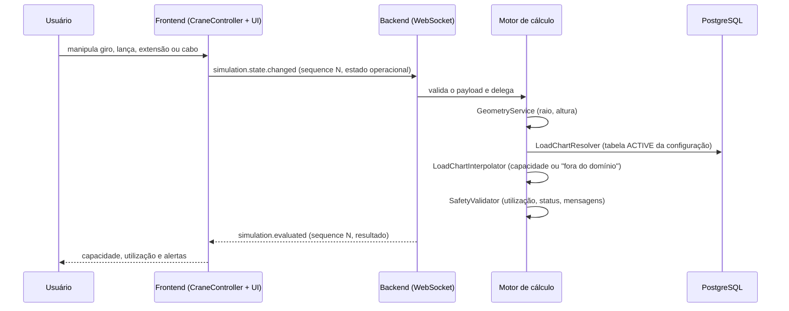

# Arquitetura

> **Status deste documento:** arquitetura **planejada; nenhum código implementado** (2026-09-26).
> Conteúdo da documentação técnica v0.1 ([`produto/documentacao-tecnica-v0.1.md`](produto/documentacao-tecnica-v0.1.md),
> citada como "doc-fonte § N"). Quando o código existir, este documento passa a descrever a
> arquitetura **como ela é**. Mudanças de arquitetura passam por ADR em [`decisions/`](decisions/README.md).

| Campo | Valor |
|-------|-------|
| Última revisão | 2026-09-26 |
| ADRs que afetam este documento | ADR-002, ADR-003; ADR-004..011 (Aceitos em 2026-09-26; decisões da doc-fonte § 7), ADR-012 (toolchain) |

---

## 1. Visão geral

Aplicação web 3D em monorepo (doc-fonte § 1 e § 7):
- **frontend** em React + TypeScript + Three.js: visualização, interação e estado gráfico;
- **backend** em FastAPI + Python, organizado em Clean Architecture: regras de domínio,
  importação/normalização das tabelas de carga, cálculo de capacidade, validações e persistência;
- **PostgreSQL** para metadados, domínio, tabelas normalizadas, simulações e resultados;
- **storage de arquivos** para GLB/glTF, planilhas e documentos originais.

A comunicação usa REST para cadastros, uploads e consultas, e WebSocket para o ciclo interativo de
avaliação (doc-fonte § 7, ADR-007 da doc-fonte).

### Diagramas

Diagramas originais em Graphviz, versionados em [`produto/diagrams/`](produto/diagrams/):

- contexto: [`01_contexto_sistema.png`](produto/diagrams/01_contexto_sistema.png)
- containers: [`02_arquitetura_containers.png`](produto/diagrams/02_arquitetura_containers.png)
- dependências da Clean Architecture: [`03_clean_architecture.png`](produto/diagrams/03_clean_architecture.png)
- deployment: [`08_deployment.png`](produto/diagrams/08_deployment.png)

---

## 2. Componentes

Localizações **planejadas** (doc-fonte §§ 9, 17 e 18). Nada disso existe ainda.

| Componente | Responsabilidade | Localização no código | Depende de |
|------------|------------------|-----------------------|------------|
| UI React | páginas, painéis, estado de aplicação | `frontend/src/{app,presentation,application}/` | domínio do cliente, adapters |
| Cena 3D | cena, câmera, controles, loaders, animação, colisão | `frontend/src/three/` | Three.js |
| `CraneController` | carregar o asset, localizar nós, aplicar transformações dentro dos limites, fornecer posições de referência; **nunca decide capacidade ou segurança** (doc-fonte § 12.2) | `frontend/src/three/crane/` | Three.js |
| Adapters do cliente | chamadas REST e WebSocket | `frontend/src/infrastructure/{api,websocket}/` | backend |
| Domínio | entidades, value objects, invariantes, serviços de cálculo puros | `backend/app/domain/` | nada |
| Aplicação | casos de uso, ports, orquestração | `backend/app/application/` | domínio |
| Infraestrutura | PostgreSQL/SQLAlchemy, repositórios, storage, importadores | `backend/app/infrastructure/` | aplicação, domínio |
| Apresentação | routers FastAPI, schemas Pydantic, handlers WebSocket | `backend/app/presentation/` | aplicação |
| Motor de cálculo | `GeometryService`, `LoadChartResolver`, `LoadChartInterpolator`, `SafetyValidator` (doc-fonte § 14.1) | `backend/app/domain/services/` | domínio |

---

## 3. Camadas e regras de dependência

Backend (doc-fonte § 18.2):

```text
Presentation ──► Application ──► Domain
Infrastructure ────────────────► Application / Domain
Domain ─X─► FastAPI / SQLAlchemy / PostgreSQL
```

- Schemas Pydantic ficam na apresentação; entidades de domínio não dependem de framework (RNF-002).
- Endpoints e repositórios são adapters; casos de uso orquestram o domínio (ADR-001 da doc-fonte).

Frontend (doc-fonte § 17.3): React não manipula diretamente os `Object3D` da cena. Um
controller/adapter expõe comandos estáveis (`setTurretRotation`, `setBoomAngle`, `setBoomLength`,
`setCableLength`, `getOperationalGeometry`).

**Agentes:** antes de criar um import, confira se a direção é permitida. Se precisar violar, é uma
decisão — abra um ADR.

---

## 4. Fluxo de dados principal

Avaliação em tempo real (doc-fonte §§ 14 e 15.4; diagrama
[`06_sequencia_calculo_tempo_real.png`](produto/diagrams/06_sequencia_calculo_tempo_real.png)):



O frontend ignora respostas com `sequence` antigo (doc-fonte § 15.4). Importação de tabela:
[`07_sequencia_importacao_tabela.png`](produto/diagrams/07_sequencia_importacao_tabela.png) e doc-fonte § 13.

---

## 5. Modelo de dados

Entidades da doc-fonte § 10 e tabelas iniciais da § 19.1. Diagrama de classes:
[`05_diagrama_classes_dominio.png`](produto/diagrams/05_diagrama_classes_dominio.png).
Migrations: ferramenta **A VALIDAR** (não definida na doc-fonte).

| Entidade | Descrição | Tabela/coleção | Campos-chave |
|----------|-----------|----------------|--------------|
| Manufacturer | fabricante | `manufacturers` | A VALIDAR |
| Crane | modelo lógico do guindaste, sem capacidade global | `cranes` | A VALIDAR |
| Crane3DModel | versão do asset visual | `crane_3d_models` | URI, formato, escala, hash, versão (doc-fonte § 19.2) |
| CraneKinematics | mapeamento de nós e limites cinemáticos | `crane_kinematics` | A VALIDAR |
| CraneConfiguration | configuração que seleciona a tabela | `crane_configurations` | atributos **PENDENTES** (PEND-005) |
| LoadChart | cabeçalho e versão da tabela; estados `DRAFT/VALIDATED/ACTIVE/SUPERSEDED/INVALID` | `load_charts` | versão, origem, estado |
| LoadChartPoint | ponto da tabela | `load_chart_points` | `boom_length`, `working_radius`, `max_capacity` (inicial) |
| Load | carga da simulação | `loads` | peso, dimensões |
| Simulation | agregado da simulação | `simulations` | A VALIDAR |
| SimulationState | snapshot operacional | `simulation_states` | A VALIDAR |
| SimulationResult | resultado do motor | `simulation_results` | capacidade, utilização, status, versão da tabela |

Arquivos (GLB/glTF, CSV/XLSX, PDFs) ficam fora do banco; o banco guarda URI, hash, versão, tipo e
metadados de rastreabilidade (doc-fonte § 19.2).

---

## 6. Integrações

Sem integração com sistemas externos em tempo de execução no MVP.

| Integração | Direção | Protocolo | Autenticação | Onde está o cliente no código | Tratamento de falha |
|------------|---------|-----------|--------------|-------------------------------|---------------------|
| Importação de tabela de carga | entrada | upload de arquivo CSV/XLSX (REST) | não definida (autenticação "futura", doc-fonte § 8.4) | `backend/app/infrastructure/importers/` (planejado) | relatório de inconsistências; não corromper dados válidos (RNF-006) |
| Importação de modelo 3D | entrada | upload de arquivo GLB/glTF (REST) | não definida | `backend/app/infrastructure/storage/` (planejado) | validação de escala, origem e pivôs (doc-fonte § 12) |

---

## 7. Configuração e ambientes

Cada ambiente corresponde a uma branch permanente (ver [ADR-002](decisions/ADR-002-modelo-de-branches-por-ambiente.md)
e [`guides/git-github.md`](guides/git-github.md) § 1). A doc-fonte só prevê o ambiente de
desenvolvimento local (§ 22). O significado de homologação e produção num projeto acadêmico está
**PENDENTE** (pendência no handoff).

| Ambiente | Branch | Onde roda | Como é configurado | Diferenças relevantes |
|----------|--------|-----------|--------------------|-----------------------|
| local | — | máquina do dev, com Docker Compose (frontend, backend, postgres) | `.env` | storage em volume local (doc-fonte § 22.1) |
| CI | — | GitHub Actions | variáveis do workflow | sem acesso a serviços externos reais |
| desenvolvimento | `development` | PENDENTE (sem implantação definida) | GitHub Environment `development` | dados sintéticos; pode ser recriado a qualquer momento |
| homologação | `homologation` | PENDENTE | GitHub Environment `homologation` | PENDENTE |
| produção | `production` | PENDENTE | GitHub Environment `production` | PENDENTE |

Variáveis de ambiente estão documentadas em `.env.example` (nomes, sem valores). Os valores de cada
ambiente ficam nos *secrets* do GitHub Environment correspondente. **Valores reais nunca ficam no
repositório.**

---

## 8. Decisões arquiteturais relevantes

Resumo com link. O detalhe está no ADR.

| ADR | Decisão | Status |
|-----|---------|--------|
| [ADR-001](decisions/ADR-001-workflow-baseado-em-arquivos.md) | Workflow de IAs baseado em arquivos versionados, sem API | Substituído por ADR-003 |
| [ADR-002](decisions/ADR-002-modelo-de-branches-por-ambiente.md) | Três branches por ambiente: `development`, `homologation`, `production` | Aceito |
| [ADR-003](decisions/ADR-003-orquestracao-local-via-clis-de-assinatura.md) | Agentes acionados manualmente ou por orquestrador local via CLIs de assinatura; sem API paga; CI sem IA | Aceito |
| [ADR-004](decisions/ADR-004-clean-architecture-no-backend.md) | Clean Architecture (doc-fonte § 7) | Aceito |
| [ADR-005](decisions/ADR-005-frontend-react-typescript-threejs.md) | Frontend React + TypeScript + Three.js (doc-fonte § 7) | Aceito |
| [ADR-006](decisions/ADR-006-backend-fastapi-python.md) | Backend FastAPI + Python (doc-fonte § 7) | Aceito |
| [ADR-007](decisions/ADR-007-postgresql.md) | PostgreSQL (doc-fonte § 7) | Aceito |
| [ADR-008](decisions/ADR-008-glb-gltf-como-formato-3d-interno.md) | GLB/glTF como formato 3D interno (doc-fonte § 7) | Aceito |
| [ADR-009](decisions/ADR-009-tabelas-de-carga-estruturadas-no-banco.md) | Tabelas estruturadas no banco (doc-fonte § 7) | Aceito |
| [ADR-010](decisions/ADR-010-rest-e-websocket.md) | REST + WebSocket (doc-fonte § 7) | Aceito |
| [ADR-011](decisions/ADR-011-monorepo.md) | Monorepo (doc-fonte § 7) | Aceito |
| [ADR-012](decisions/ADR-012-toolchain-de-desenvolvimento.md) | Toolchain: Python 3.14 + uv, ruff, mypy, pytest, import-linter, Alembic; Node 24 + npm, Vite, Three.js puro, Vitest, ESLint, Prettier | Aceito |
| [ADR-013](decisions/ADR-013-convencoes-geometricas-provisorias.md) | Convenções geométricas provisórias: sistema destro com Y para cima, metros e graus; raio medido do eixo de giro até a vertical do gancho (A VALIDAR); parâmetros geométricos vindos da ficha técnica no backend, que é a fonte de verdade | Proposto |

---

## 9. O que os agentes NÃO devem presumir

- Que existe código, pasta `frontend/` ou `backend/`, dependência instalada ou comando funcionando: nada disso existe ainda.
- Que os números dos exemplos da doc-fonte (§§ 14.2, 14.3 e 15.4) são capacidades ou tolerâncias reais: são ilustrativos.
- Qualquer regra de interpolação, arredondamento, nível de alerta ou extrapolação: estão **PENDENTES** (PEND-001..004; RN-007).
- A geometria de cálculo (referência do raio, altura do gancho, offsets): não definida na doc-fonte.
- Veja também [`known-gaps.md`](known-gaps.md).
