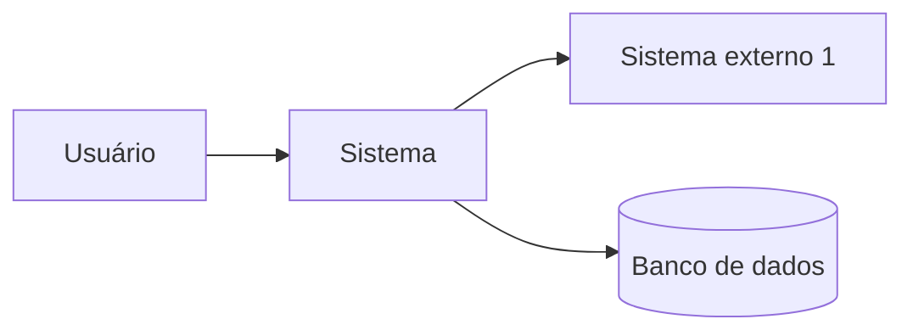
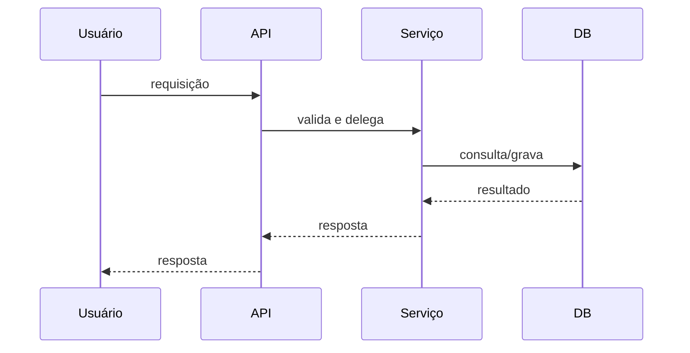

# Arquitetura

> **Status deste documento:** `<preencher>`. Este documento descreve a arquitetura **como ela é**,
> não como gostaríamos que fosse. Mudanças de arquitetura passam por ADR em
> [`decisions/`](decisions/README.md) antes de serem refletidas aqui.

| Campo | Valor |
|-------|-------|
| Última revisão | `<AAAA-MM-DD>` |
| ADRs que afetam este documento | `<ADR-001, ADR-002...>` |

---

## 1. Visão geral

`<preencher>` — Um parágrafo: estilo arquitetural (monólito, monólito modular, microsserviços,
serverless...), principais blocos e como se comunicam.

### Diagrama de contexto



*(substitua pelo diagrama real; Mermaid renderiza no GitHub e no Obsidian)*

---

## 2. Componentes

| Componente | Responsabilidade | Localização no código | Depende de |
|------------|------------------|-----------------------|------------|
| `<preencher>` | `<preencher>` | `src/<pasta>/` | `<preencher>` |

Regra: um componente, uma responsabilidade. Se a coluna "Responsabilidade" precisa de "e", provavelmente
são dois componentes.

---

## 3. Camadas e regras de dependência

`<preencher>` — Descreva as camadas (ex.: apresentação → aplicação → domínio → infraestrutura) e a
direção permitida das dependências.

```text
Exemplo:
  api/        → pode importar de: services/, domain/
  services/   → pode importar de: domain/, repositories/
  domain/     → não importa de nenhuma outra camada
  repositories/ → pode importar de: domain/
```

**Agentes:** antes de criar um import, confira se a direção é permitida. Se precisar violar, é uma
decisão — abra um ADR.

---

## 4. Fluxo de dados principal

`<preencher>` — Descreva o caminho de uma requisição/evento típico, do início ao fim.



---

## 5. Modelo de dados

`<preencher>` — Entidades principais e relacionamentos. Se houver migrations, indique onde ficam
e como são geradas (detalhes operacionais em [`development-guide.md`](development-guide.md)).

| Entidade | Descrição | Tabela/coleção | Campos-chave |
|----------|-----------|----------------|--------------|
| `<preencher>` | `<preencher>` | `<preencher>` | `<preencher>` |

---

## 6. Integrações

| Integração | Direção | Protocolo | Autenticação | Onde está o cliente no código | Tratamento de falha |
|------------|---------|-----------|--------------|-------------------------------|---------------------|
| `<preencher>` | entrada/saída | REST/gRPC/fila/arquivo | `<tipo, não o segredo>` | `src/...` | retry? fallback? |

---

## 7. Configuração e ambientes

Cada ambiente corresponde a uma branch permanente (ver [ADR-002](decisions/ADR-002-modelo-de-branches-por-ambiente.md)
e [`guides/git-github.md`](guides/git-github.md) § 1).

| Ambiente | Branch | Onde roda | Como é configurado | Diferenças relevantes |
|----------|--------|-----------|--------------------|-----------------------|
| local | — | máquina do dev | `.env` | `<preencher>` |
| CI | — | GitHub Actions | variáveis do workflow | sem acesso a serviços externos reais |
| desenvolvimento | `development` | `<preencher>` | GitHub Environment `development` | dados sintéticos; pode ser recriado a qualquer momento |
| homologação | `homologation` | `<preencher>` | GitHub Environment `homologation` | espelha produção; usado por QA/cliente |
| produção | `production` | `<preencher>` | GitHub Environment `production` | dados reais; mudanças só por promoção |

Variáveis de ambiente estão documentadas em `.env.example` (nomes, sem valores). Os valores de cada
ambiente ficam nos *secrets* do GitHub Environment correspondente. **Valores reais nunca ficam no
repositório.**

---

## 8. Decisões arquiteturais relevantes

Resumo com link. O detalhe está no ADR.

| ADR | Decisão | Status |
|-----|---------|--------|
| [ADR-001](decisions/ADR-001-workflow-baseado-em-arquivos.md) | Workflow de IAs baseado em arquivos versionados, sem API | Substituído por ADR-003 |
| [ADR-002](decisions/ADR-002-modelo-de-branches-por-ambiente.md) | Três branches por ambiente: `development`, `homologation`, `production` | Aceito |
| [ADR-003](decisions/ADR-003-orquestracao-local-via-clis-de-assinatura.md) | Agentes acionados manualmente ou por orquestrador local via CLIs de assinatura; sem API paga; CI sem IA | Aceito |
| `<ADR-00X>` | `<preencher>` | `<preencher>` |

---

## 9. O que os agentes NÃO devem presumir

- `<preencher>` — ex.: "que existe cache"; "que o banco aceita transações distribuídas"
- Veja também [`known-gaps.md`](known-gaps.md).
