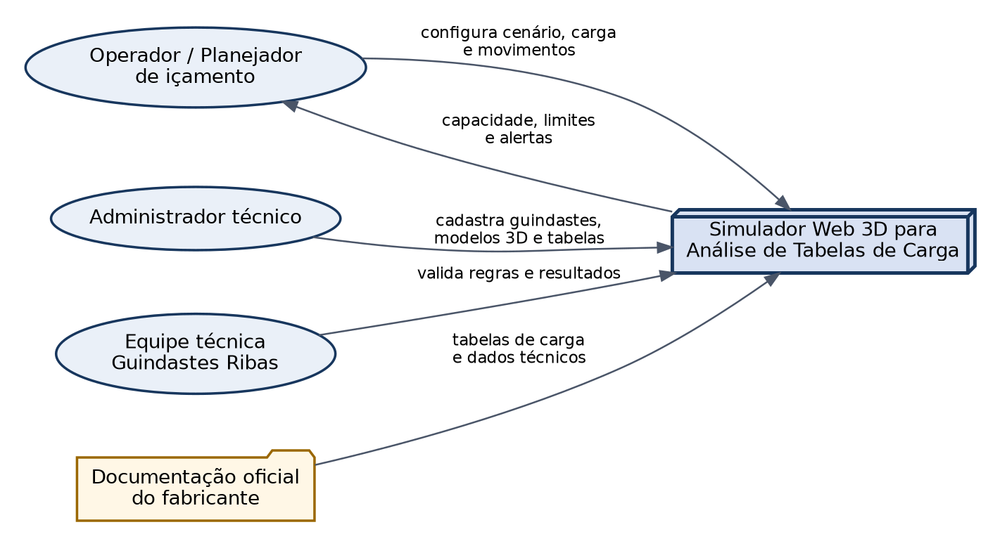
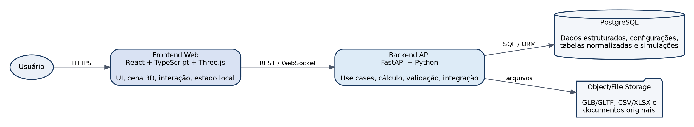
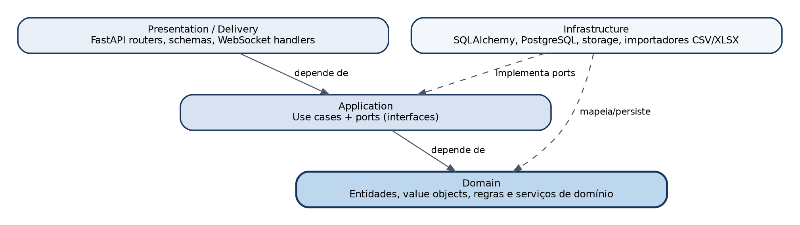
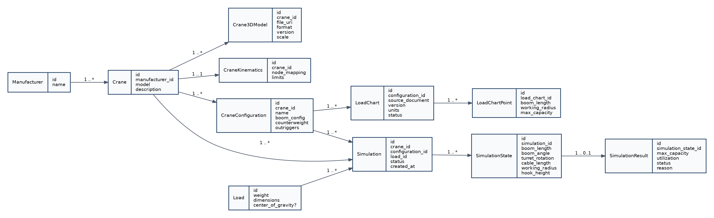
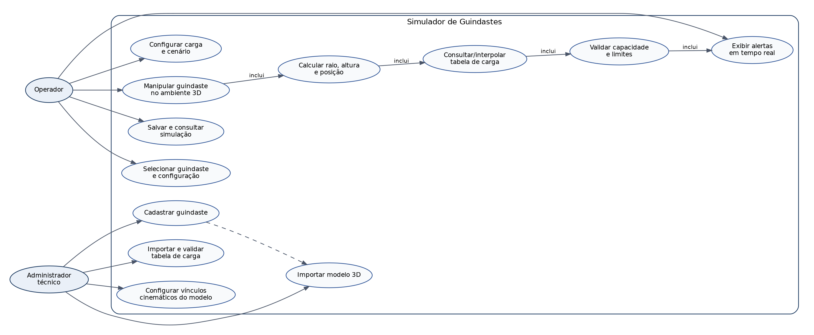
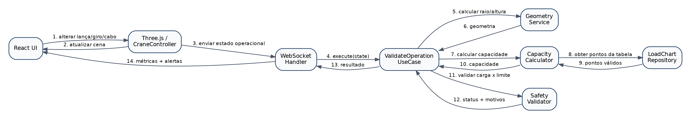
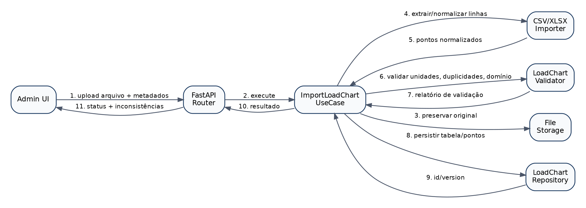
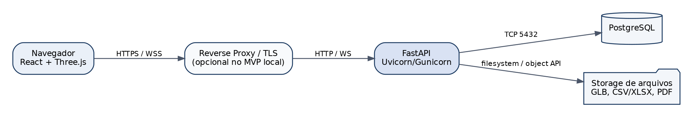

# Documentação Técnica Consolidada - Simulador Web 3D para Análise de Tabelas de Carga de Guindastes

**Versão:** 0.1  
**Data:** 13/08/2026  
**Curso:** Engenharia de Software - 2º semestre letivo de 2026  
**Empresa parceira:** Guindastes Ribas Ltda.  
**Base acadêmica:** *Roteiro Geral da Jornada de Aprendizagem - 2026/2*

> **Legenda de origem**  
> **[FONTE]** requisito ou objetivo explicitamente sustentado pelo roteiro acadêmico.  
> **[DECISÃO]** decisão técnica consolidada nas discussões do projeto.  
> **[PROPOSTA]** detalhamento de engenharia recomendado para viabilizar o desenvolvimento.  
> **[PENDENTE]** ponto que depende de validação com a empresa parceira e/ou documentação oficial do fabricante.

---

## 1. Visão executiva

[FONTE] O desafio do semestre é construir uma ferramenta gráfica interativa para manipular guindaste, lança e carga, calcular dinamicamente limites operacionais de içamento e emitir alertas de segurança em tempo real. O roteiro também exige estudo de tabelas de carga, raio de trabalho e comprimento de lança; modelagem UML; motor de cálculo com interpolação; integração com o Canvas; testes; e validação dos cálculos contra tabelas oficiais do fabricante.

[DECISÃO] A solução será uma aplicação web 3D com **React + TypeScript + Three.js** no frontend e **FastAPI + Python** no backend, organizada segundo **Clean Architecture**. O frontend será responsável por visualização, interação e estado gráfico; o backend concentrará regras de domínio, importação/normalização das tabelas de carga, cálculo de capacidade, validações e persistência.

### 1.1 Objetivo do produto

Permitir que um usuário selecione um guindaste e sua configuração, posicione/manipule o equipamento e uma carga em um ambiente 3D, obtenha raio de trabalho, altura e demais parâmetros operacionais e receba a capacidade admissível e alertas calculados a partir da tabela oficial vinculada à configuração selecionada.

### 1.2 Resultado esperado do MVP

1. cadastrar ao menos um modelo de guindaste;
2. importar e visualizar seu modelo 3D;
3. configurar os vínculos cinemáticos básicos do modelo;
4. importar ao menos uma tabela de carga estruturada;
5. configurar uma carga;
6. manipular giro, lança, extensão e cabo no cenário;
7. calcular dinamicamente os parâmetros geométricos relevantes;
8. consultar/interpolar a tabela de carga;
9. comparar carga atual com a capacidade calculada;
10. exibir o resultado e alertas em tempo real;
11. registrar dados suficientes para testar e reproduzir a simulação.

---

## 2. Escopo

### 2.1 Dentro do escopo

- visualização 3D de guindastes e cargas;
- importação de modelos 3D preparados para o simulador;
- manipulação de componentes articulados do guindaste;
- cadastro de fabricantes, modelos e configurações;
- importação de tabelas de carga CSV/XLSX;
- preservação do documento original da tabela para rastreabilidade;
- normalização de unidades e dados;
- cálculo de raio de trabalho e parâmetros geométricos necessários;
- algoritmo de interpolação/consulta das tabelas de carga;
- alertas de operação conforme regras técnicas cadastradas;
- armazenamento de simulações e resultados;
- testes unitários do motor de cálculo;
- testes de integração API e testes de usabilidade da interface 3D;
- validação dos cálculos com tabelas oficiais do fabricante.

### 2.2 Fora do MVP inicial

- certificação formal de operações reais de içamento;
- cálculo estrutural completo do guindaste;
- simulação física avançada de deformação de lança/cabos;
- modelagem geotécnica do solo;
- integração direta com telemetria de guindastes reais;
- importação automática de qualquer CAD sem preparação/conversão;
- reconhecimento universal de tabelas a partir de PDFs não estruturados.

### 2.3 Premissa de segurança

[PROPOSTA] O produto deve ser tratado como ferramenta de planejamento e análise. Qualquer regra que afete capacidade operacional precisa estar vinculada à documentação oficial do fabricante e validada com a empresa parceira. O sistema não deve inventar capacidade fora do domínio conhecido da tabela.

---

## 3. Stakeholders e perfis

| Perfil | Responsabilidades principais |
|---|---|
| Operador / Planejador | Selecionar equipamento, configurar carga, manipular cenário, analisar capacidade e alertas. |
| Administrador técnico | Cadastrar guindastes, modelos 3D, configurações e tabelas de carga. |
| Equipe técnica da empresa | Fornecer/validar dados oficiais, regras de uso e resultados do simulador. |
| Equipe de desenvolvimento | Implementar, testar, documentar e manter a solução. |
| Professores / banca | Avaliar requisitos, modelagem, arquitetura, MVP, testes e apresentação final. |

---

## 4. Requisitos funcionais

| ID | Requisito | Prioridade |
|---|---|---|
| RF-001 | Cadastrar fabricantes de guindastes. | Deve |
| RF-002 | Cadastrar modelos de guindastes. | Deve |
| RF-003 | Importar modelo 3D de um guindaste em formato interno GLB/glTF. | Deve |
| RF-004 | Configurar escala, orientação e nós/articulações do modelo 3D. | Deve |
| RF-005 | Cadastrar múltiplas configurações operacionais para um guindaste. | Deve |
| RF-006 | Importar tabela de carga em CSV/XLSX. | Deve |
| RF-007 | Vincular uma tabela de carga a uma configuração específica do guindaste. | Deve |
| RF-008 | Preservar metadados e documento-fonte da tabela importada. | Deve |
| RF-009 | Validar e normalizar unidades e pontos da tabela. | Deve |
| RF-010 | Selecionar guindaste e configuração para uma nova simulação. | Deve |
| RF-011 | Criar/configurar carga com peso e dimensões. | Deve |
| RF-012 | Manipular giro da superestrutura/torre. | Deve |
| RF-013 | Manipular inclinação e comprimento/extensão da lança. | Deve |
| RF-014 | Manipular comprimento do cabo/posição do gancho. | Deve |
| RF-015 | Calcular raio de trabalho e altura/posição do gancho em tempo de execução. | Deve |
| RF-016 | Consultar ou interpolar a capacidade correspondente na tabela vinculada. | Deve |
| RF-017 | Comparar carga informada com a capacidade calculada. | Deve |
| RF-018 | Exibir capacidade, utilização, raio, comprimento de lança e status da operação. | Deve |
| RF-019 | Emitir alertas em tempo real quando uma regra operacional for violada. | Deve |
| RF-020 | Rejeitar ou sinalizar consulta fora do domínio suportado pela tabela. | Deve |
| RF-021 | Salvar uma simulação e seu estado relevante. | Deveria |
| RF-022 | Consultar simulações previamente salvas. | Deveria |
| RF-023 | Exportar um resumo técnico da simulação. | Poderia |
| RF-024 | Permitir cadastrar obstáculos no cenário para análise geométrica básica. | Poderia |

---

## 5. Requisitos não funcionais

| ID | Requisito |
|---|---|
| RNF-001 | O motor de cálculo deve possuir testes unitários independentes da API e do banco. |
| RNF-002 | Regras de domínio não podem depender diretamente de FastAPI, SQLAlchemy, Three.js ou React. |
| RNF-003 | O cálculo de uma alteração operacional deve responder rápido o suficiente para uso interativo; a meta inicial é retorno perceptualmente imediato em ambiente local, a ser medida no MVP. |
| RNF-004 | Modelos 3D devem usar escala física consistente, preferencialmente metros como unidade interna. |
| RNF-005 | Toda tabela de carga deve ter versão e origem rastreáveis. |
| RNF-006 | Importações inválidas devem produzir relatório de inconsistências e não corromper dados válidos existentes. |
| RNF-007 | O backend deve expor contrato OpenAPI e validar payloads. |
| RNF-008 | O código deve possuir tipagem estática no frontend e type hints no backend. |
| RNF-009 | A aplicação deve suportar navegadores desktop modernos com WebGL. |
| RNF-010 | As regras de cálculo devem ser reproduzíveis com os mesmos dados de entrada e versão de tabela. |
| RNF-011 | O projeto deve manter documentação técnica e diagramas versionados no repositório. |
| RNF-012 | O sistema deve permitir adicionar novos modelos/configurações sem alterar o núcleo do motor de cálculo. |

---

## 6. Regras de negócio e pontos de validação

### 6.1 Regras consolidadas

- RN-001: uma **LoadChart** pertence a uma **CraneConfiguration**, não apenas ao modelo genérico do guindaste;
- RN-002: a configuração deve representar, quando aplicável, informações como lança, jib, contrapeso, estabilizadores e demais condições que alterem a tabela;
- RN-003: o arquivo 3D não define capacidade; ele fornece representação e cinemática;
- RN-004: a capacidade admissível sempre deve resultar da tabela/regra oficial vinculada à configuração selecionada;
- RN-005: cada cálculo deve registrar a versão da tabela usada;
- RN-006: valores de entrada e saída devem ser normalizados em unidades internas consistentes;
- RN-007: consultas fora dos limites conhecidos da tabela devem ser identificadas explicitamente;
- RN-008: o estado visual do frontend não é fonte de verdade para a regra de capacidade; o backend deve validar os dados operacionais recebidos.

### 6.2 Pontos pendentes de validação com a empresa

- PEND-001: método exato de interpolação permitido para cada tabela/fabricante;
- PEND-002: política de arredondamento;
- PEND-003: se determinados campos devem utilizar valor mais conservador em vez de interpolação;
- PEND-004: limites e níveis dos alertas (normal, atenção, crítico);
- PEND-005: quais configurações físicas precisam obrigatoriamente participar da seleção da tabela;
- PEND-006: tratamento de acessórios, moitões, cabos e pesos auxiliares;
- PEND-007: necessidade de considerar setores de giro diferentes;
- PEND-008: formato real das tabelas que a empresa irá fornecer.

---

## 7. Decisões arquiteturais

### ADR-001 - Clean Architecture

**Decisão:** adotar Clean Architecture no backend.  
**Motivo:** isolar regras de domínio e motor de cálculo dos frameworks, banco e formatos de entrada.  
**Consequência:** endpoints e repositórios tornam-se adapters; casos de uso orquestram o domínio.

### ADR-002 - Frontend React + TypeScript + Three.js

**Decisão:** React gerencia UI e estado de aplicação; Three.js gerencia cena 3D e interação gráfica.  
**Regra:** evitar componentes React contendo diretamente toda a lógica Three.js; usar controllers/adapters próprios para a cena.

### ADR-003 - Backend FastAPI + Python

**Decisão:** FastAPI será o delivery mechanism HTTP/WebSocket.  
**Regra:** schemas Pydantic ficam na camada de apresentação; entidades de domínio permanecem independentes.

### ADR-004 - PostgreSQL

**Decisão:** PostgreSQL para metadados, domínio, tabelas normalizadas, simulações e resultados.

### ADR-005 - GLB/glTF como formato 3D interno

**Decisão:** arquivos CAD originais podem vir em outros formatos, mas o runtime web trabalhará com GLB/glTF preparado.  
**Motivo:** hierarquia de nós, materiais e integração direta com Three.js.

### ADR-006 - Tabelas estruturadas no banco

**Decisão:** CSV/XLSX serão importados e normalizados; o documento original será preservado separadamente.  
**Motivo:** cálculo não deve depender de leitura de planilha a cada frame/interação.

### ADR-007 - REST + WebSocket

**REST:** cadastros, uploads, consultas, criação/carregamento de simulações.  
**WebSocket:** ciclo interativo de atualização operacional e retorno de capacidade/alertas.

### ADR-008 - Monorepo

**Decisão:** manter frontend, backend e documentação em um único repositório acadêmico.

---

## 8. Arquitetura de software

### 8.1 Diagrama de contexto



### 8.2 Containers



### 8.3 Dependências da Clean Architecture



### 8.4 Responsabilidades por camada

| Camada | Responsabilidades |
|---|---|
| Domain | Entidades, value objects, invariantes, serviços de cálculo puros. |
| Application | Use cases, ports/interfaces, transações e orquestração. |
| Infrastructure | PostgreSQL, SQLAlchemy, storage, importadores, implementações dos ports. |
| Presentation | FastAPI routers, Pydantic schemas, autenticação futura e handlers WebSocket. |

---

## 9. Estrutura recomendada do repositório

```text
crane-simulator/
├── frontend/
│   ├── src/
│   │   ├── app/
│   │   ├── domain/
│   │   ├── application/
│   │   ├── infrastructure/
│   │   ├── presentation/
│   │   └── three/
│   │       ├── scene/
│   │       ├── camera/
│   │       ├── controls/
│   │       ├── loaders/
│   │       ├── crane/
│   │       ├── animation/
│   │       └── collision/
│   └── tests/
├── backend/
│   ├── app/
│   │   ├── domain/
│   │   │   ├── entities/
│   │   │   ├── value_objects/
│   │   │   ├── services/
│   │   │   └── exceptions/
│   │   ├── application/
│   │   │   ├── ports/
│   │   │   └── use_cases/
│   │   ├── infrastructure/
│   │   │   ├── database/
│   │   │   ├── repositories/
│   │   │   ├── storage/
│   │   │   └── importers/
│   │   └── presentation/
│   │       ├── api/
│   │       └── websocket/
│   └── tests/
├── docs/
│   ├── architecture/
│   ├── requirements/
│   ├── uml/
│   ├── adr/
│   └── load-charts/
├── assets/example-models/
├── docker/
├── docker-compose.yml
└── README.md
```

---

## 10. Modelo de domínio

### 10.1 Diagrama de classes



### 10.2 Entidades principais

#### Manufacturer
Identifica o fabricante e permite organizar modelos e documentação.

#### Crane
Representa o modelo lógico do guindaste. Não deve armazenar uma única capacidade global porque a capacidade varia por configuração operacional.

#### Crane3DModel
Representa uma versão do asset visual, com URI, formato, escala e metadados.

#### CraneKinematics
Mapeia os nós do GLB/glTF para funções do simulador, por exemplo `turret`, `boom`, `boom_tip`, `hook`, e registra limites cinemáticos conhecidos.

#### CraneConfiguration
Representa uma configuração operacional capaz de selecionar uma tabela específica.

#### LoadChart
Cabeçalho/versionamento de uma tabela oficial normalizada.

#### LoadChartPoint
Ponto discreto da tabela, inicialmente modelado por `boom_length`, `working_radius` e `max_capacity`, extensível conforme a estrutura real das tabelas.

#### Load
Carga da simulação, com peso e dimensões. O centro de gravidade permanece opcional até validação do escopo.

#### Simulation
Agrega equipamento, configuração, carga, status e histórico relevante.

#### SimulationState
Snapshot operacional: comprimento/ângulo da lança, giro, cabo, raio, altura etc.

#### SimulationResult
Resultado do motor: capacidade admissível, utilização, status e motivos/alertas.

---

## 11. Casos de uso



### 11.1 Use cases de aplicação sugeridos

- `CreateCrane`
- `UpdateCrane`
- `ImportCrane3DModel`
- `ConfigureCraneKinematics`
- `CreateCraneConfiguration`
- `ImportLoadChart`
- `ValidateLoadChart`
- `CreateSimulation`
- `UpdateSimulationState`
- `CalculateGeometry`
- `CalculateCapacity`
- `ValidateOperation`
- `SaveSimulationSnapshot`
- `GetSimulation`

---

## 12. Fluxo do modelo 3D

```text
Arquivo CAD / modelo original
          ↓
Conversão e preparação fora do runtime
          ↓
GLB / glTF otimizado
          ↓
Upload para storage
          ↓
Cadastro Crane3DModel
          ↓
Mapeamento dos nós cinemáticos
          ↓
Validação de escala/origem/pivôs
          ↓
Carregamento pelo Three.js
```

### 12.1 Requisitos do asset

- escala conhecida e consistente;
- partes móveis separadas em nós;
- pivôs colocados nas articulações reais;
- nomes de nós estáveis ou mapeamento configurável;
- complexidade poligonal compatível com uso web;
- versão do asset rastreável;
- testes visuais de rotação, inclinação e extensão.

### 12.2 Responsabilidades do `CraneController`

- carregar a estrutura do asset;
- localizar nós configurados;
- aplicar transformações dentro dos limites conhecidos;
- fornecer posições de referência em coordenadas de mundo;
- nunca decidir capacidade ou segurança da operação.

---

## 13. Fluxo das tabelas de carga

```text
PDF / XLSX / CSV oficial
        ↓
Preservação do arquivo-fonte
        ↓
Importação estruturada CSV/XLSX
        ↓
Normalização de unidades
        ↓
Validação de cabeçalhos e dados
        ↓
Versionamento da LoadChart
        ↓
Persistência dos LoadChartPoints
        ↓
Disponibilização ao motor de cálculo
```

### 13.1 Validações mínimas na importação

- campos obrigatórios presentes;
- valores numéricos válidos;
- unidades reconhecidas;
- ausência de linhas duplicadas conflitantes;
- comprimentos/raios ordenáveis;
- capacidades não negativas;
- vínculo com configuração existente;
- versão/origem informadas;
- relatório de inconsistências antes da ativação da tabela.

### 13.2 Estado da tabela

Sugestão de estados:

```text
DRAFT → VALIDATED → ACTIVE → SUPERSEDED
   ↘ INVALID
```

Somente tabelas `ACTIVE` devem participar de novas simulações, salvo modo técnico de validação.

---

## 14. Motor de cálculo

### 14.1 Separação interna

```text
GeometryService
  └─ calcula grandezas geométricas a partir do estado operacional

LoadChartResolver
  └─ identifica tabela ativa e domínio aplicável

LoadChartInterpolator
  └─ obtém capacidade para os valores consultados

SafetyValidator
  └─ compara carga, capacidade e demais regras
```

### 14.2 Entrada conceitual

```json
{
  "crane_id": "...",
  "configuration_id": "...",
  "boom_length_m": 18.2,
  "boom_angle_deg": 42.0,
  "turret_rotation_deg": 120.0,
  "cable_length_m": 8.4,
  "load_weight_kg": 5000.0
}
```

### 14.3 Saída conceitual

```json
{
  "working_radius_m": 13.5,
  "hook_height_m": 11.7,
  "maximum_capacity_kg": 5200.0,
  "utilization_percent": 96.15,
  "status": "WARNING",
  "load_chart_version": "2026-01",
  "messages": []
}
```

### 14.4 Interpolação - decisão ainda aberta

[FONTE] O roteiro exige um algoritmo de interpolação.  
[PENDENTE] A técnica específica não está definida no documento e deve ser validada com a estrutura real das tabelas e as regras do fabricante. A implementação deve ser encapsulada atrás de uma interface, permitindo substituir a estratégia sem alterar os use cases.

Interface conceitual:

```python
class LoadChartInterpolator(Protocol):
    def calculate_capacity(self, chart, query) -> CapacityResult:
        ...
```

[PROPOSTA] Quando uma consulta estiver fora do domínio conhecido, retornar erro de domínio/resultado não suportado em vez de extrapolar silenciosamente.

---

## 15. API proposta

### 15.1 Crane

```text
GET    /api/v1/cranes
POST   /api/v1/cranes
GET    /api/v1/cranes/{crane_id}
PATCH  /api/v1/cranes/{crane_id}
POST   /api/v1/cranes/{crane_id}/models
GET    /api/v1/cranes/{crane_id}/configurations
POST   /api/v1/cranes/{crane_id}/configurations
```

### 15.2 Load charts

```text
POST   /api/v1/load-charts/import
GET    /api/v1/load-charts/{load_chart_id}
POST   /api/v1/load-charts/{load_chart_id}/validate
POST   /api/v1/load-charts/{load_chart_id}/activate
```

### 15.3 Simulations

```text
POST   /api/v1/simulations
GET    /api/v1/simulations/{simulation_id}
PATCH  /api/v1/simulations/{simulation_id}
POST   /api/v1/simulations/{simulation_id}/evaluate
```

### 15.4 WebSocket

```text
WS /api/v1/ws/simulations/{simulation_id}
```

Mensagem de entrada sugerida:

```json
{
  "type": "simulation.state.changed",
  "sequence": 101,
  "payload": {
    "boom_length_m": 18.2,
    "boom_angle_deg": 42,
    "turret_rotation_deg": 120,
    "cable_length_m": 8.4,
    "load_weight_kg": 5000
  }
}
```

Resposta:

```json
{
  "type": "simulation.evaluated",
  "sequence": 101,
  "payload": {
    "working_radius_m": 13.5,
    "maximum_capacity_kg": 5200,
    "utilization_percent": 96.15,
    "status": "WARNING"
  }
}
```

O campo `sequence` permite ao frontend ignorar respostas antigas em interações rápidas.

---

## 16. Diagramas de sequência

### 16.1 Avaliação em tempo real



### 16.2 Importação de tabela de carga



---

## 17. Frontend

### 17.1 Módulos

```text
src/
├── app/                  # bootstrap, router, providers
├── domain/               # tipos e regras locais independentes da UI
├── application/          # casos de uso do cliente / orchestration
├── infrastructure/
│   ├── api/
│   └── websocket/
├── presentation/
│   ├── pages/
│   ├── components/
│   └── panels/
└── three/
    ├── scene/
    ├── camera/
    ├── controls/
    ├── loaders/
    ├── crane/
    ├── animation/
    └── collision/
```

### 17.2 Estado mínimo da tela de simulação

- `selectedCrane`
- `selectedConfiguration`
- `load`
- `craneState`
- `evaluationResult`
- `connectionStatus`
- `selection3D`
- `camera/UIState` (somente apresentação)

### 17.3 Regra de integração React/Three.js

React não deve manipular diretamente cada `Object3D` em dezenas de componentes. Um adapter/controller deve fornecer comandos estáveis:

```ts
craneController.setTurretRotation(deg)
craneController.setBoomAngle(deg)
craneController.setBoomLength(m)
craneController.setCableLength(m)
craneController.getOperationalGeometry()
```

---

## 18. Backend

### 18.1 Estrutura

```text
app/
├── domain/
│   ├── entities/
│   ├── value_objects/
│   ├── services/
│   └── exceptions/
├── application/
│   ├── ports/
│   └── use_cases/
├── infrastructure/
│   ├── database/
│   ├── repositories/
│   ├── storage/
│   └── importers/
└── presentation/
    ├── api/
    └── websocket/
```

### 18.2 Dependency rule

```text
Presentation ──► Application ──► Domain
Infrastructure ────────────────► Application / Domain
Domain ─X─► FastAPI / SQLAlchemy / PostgreSQL
```

---

## 19. Persistência

### 19.1 Tabelas iniciais

- `manufacturers`
- `cranes`
- `crane_3d_models`
- `crane_kinematics`
- `crane_configurations`
- `load_charts`
- `load_chart_points`
- `loads`
- `simulations`
- `simulation_states`
- `simulation_results`

### 19.2 Arquivos fora do banco relacional

- modelos GLB/glTF;
- planilhas CSV/XLSX originais;
- PDFs/documentos oficiais;
- anexos futuros.

O banco armazena URI, hash, versão, tipo e metadados de rastreabilidade.

---

## 20. Estratégia de testes

### 20.1 Unitários - prioridade máxima

- value objects de peso, distância e ângulo;
- validação de domínio;
- normalização de unidades;
- consulta/interpolação;
- comportamento fora da tabela;
- cálculo de utilização;
- seleção de tabela/configuração;
- regras do `SafetyValidator`.

### 20.2 Integração

- repositórios PostgreSQL;
- importação CSV/XLSX;
- endpoints FastAPI;
- WebSocket;
- storage de arquivos.

### 20.3 Frontend

- reducers/stores e hooks;
- adapters de API;
- transformação do estado de UI em `CraneState`;
- testes do `CraneController` onde possível;
- teste de usabilidade e operação do Canvas conforme exigido pelo roteiro.

### 20.4 Golden tests de cálculo

[PROPOSTA] Criar uma suíte de casos extraídos das tabelas oficiais:

```text
entrada conhecida → capacidade esperada → tolerância definida
```

Esses casos devem ser usados na validação exigida na Estação 4.

---

## 21. Observabilidade e rastreabilidade

Para cada avaliação relevante, registrar pelo menos:

- `simulation_id`;
- timestamp;
- versão da configuração;
- versão da tabela;
- entradas normalizadas;
- estratégia de interpolação;
- resultado calculado;
- status e mensagens.

Logs técnicos não devem substituir os dados persistidos necessários à reprodução de um resultado.

---

## 22. Deployment



### 22.1 Ambiente de desenvolvimento

```text
Docker Compose
├── frontend
├── backend
└── postgres
```

Storage pode inicialmente utilizar volume local; em implantação futura pode ser substituído por object storage sem modificar casos de uso, por meio de um `FileStoragePort`.

---

## 23. Plano de desenvolvimento alinhado à Jornada

### Agosto-Setembro - Estação 1

- validar problema com a empresa;
- fechar glossário técnico;
- obter exemplos reais de tabelas;
- confirmar formato dos modelos 3D/CAD;
- revisar RF/RNF e regras pendentes;
- consolidar escopo e APS 1.

### Setembro-Outubro - Estação 2

- protótipo UX/UI;
- diagrama de casos de uso;
- diagrama de classes;
- diagramas de sequência;
- prova de conceito Three.js carregando um guindaste;
- prova de conceito de importação de uma tabela.

### Outubro-Novembro - Estação 3

- implementar esqueleto Clean Architecture;
- CRUD de guindastes/configurações;
- pipeline GLB;
- importação/normalização da tabela;
- motor de cálculo;
- integração Three.js ↔ API/WS;
- entregar MVP funcional e APS 2.

### Novembro-Dezembro - Estação 4

- suíte de testes;
- golden tests com dados oficiais;
- testes de usabilidade;
- otimização da interface 3D;
- documentação final;
- demonstração Pré-Banca 2.

### Dezembro - Estação 5

- correções finais;
- congelamento/versionamento dos assets e tabelas de demonstração;
- organização do repositório;
- roteiro de demo reproduzível;
- banca final.

---

## 24. Definition of Done do MVP

O MVP só deve ser considerado concluído quando:

- [ ] um guindaste real/de demonstração estiver cadastrado;
- [ ] seu modelo GLB/glTF carregar corretamente no navegador;
- [ ] os movimentos principais estiverem vinculados aos nós corretos;
- [ ] uma configuração operacional estiver cadastrada;
- [ ] uma tabela de carga oficial/de validação estiver importada e versionada;
- [ ] uma carga puder ser configurada;
- [ ] o usuário puder alterar o estado do guindaste pelo Canvas/controles;
- [ ] raio e parâmetros geométricos forem recalculados;
- [ ] o backend resolver capacidade para a posição;
- [ ] o sistema sinalizar situação dentro/fora do domínio conhecido;
- [ ] alertas forem apresentados ao usuário;
- [ ] casos de cálculo conhecidos passarem nos testes;
- [ ] a simulação de demonstração puder ser repetida do início ao fim.

---

## 25. Riscos técnicos

| Risco | Impacto | Mitigação |
|---|---|---|
| Modelo CAD muito pesado ou inadequado para web | Alto | Pipeline de conversão/otimização para GLB. |
| Pivôs/nós do modelo não preparados | Alto | Checklist de preparação + mapeamento configurável. |
| Tabelas com formatos diferentes | Alto | Importer por adapter + formato normalizado interno. |
| Regra de interpolação ambígua | Muito alto | Validar com empresa/fabricante antes de consolidar algoritmo. |
| Unidade/escala incorreta | Muito alto | Unidade interna padrão, metadados e testes de calibração. |
| Cálculo correto, mas resposta visual atrasada | Médio | Debounce/throttle, sequence IDs, perfil de performance. |
| Frontend concentrar regras de segurança | Alto | Backend como fonte de verdade e testes de domínio. |
| Escopo crescer para simulador físico completo | Alto | Manter MVP focado em tabela de carga + geometria + interação. |

---

## 26. Questões a levar para a Guindastes Ribas

1. Quais fabricantes e modelos devem ser usados na primeira demonstração?
2. Em quais formatos estão disponíveis os desenhos/modelos dos guindastes?
3. A empresa consegue fornecer modelo 3D com partes móveis separadas?
4. Quais tabelas de carga podem ser disponibilizadas para desenvolvimento?
5. As tabelas estão em PDF, Excel, CSV ou outro formato?
6. Quais configurações alteram a tabela de carga para o modelo selecionado?
7. A interpolação é permitida? Em quais dimensões e com quais regras?
8. Como tratar pontos não existentes ou valores entre células?
9. É permitido extrapolar algum valor? Se não, qual mensagem deve ser apresentada?
10. Quais unidades são usadas nas tabelas?
11. Há pesos de acessórios que precisam ser subtraídos da capacidade nominal?
12. Quais limites devem gerar aviso versus bloqueio?
13. Quais cenários reais seriam bons casos de teste para a banca?
14. Que informação um operador espera ver para considerar a ferramenta útil?
15. Quais resultados precisam aparecer em um relatório final de simulação?

---

## 27. Fonte acadêmica

Documento-base: **Roteiro Geral da Jornada de Aprendizagem - 2026/2**, Curso de Engenharia de Software, desafio industrial “Ferramenta Gráfica Interativa para Análise de Tabelas de Carga de Guindastes”, empresa parceira Guindastes Ribas Ltda.

Pontos explicitamente extraídos do roteiro e usados nesta consolidação:

- interface gráfica interativa/Canvas para guindaste, lança e carga;
- cálculo dinâmico dos limites operacionais;
- alertas de segurança em tempo real;
- estudo de tabelas de carga, raio de trabalho e comprimento de lança;
- RF e RNF;
- UML: casos de uso, classes e sequência;
- arquitetura do software;
- motor de cálculo com algoritmo de interpolação;
- integração Canvas + motor de cálculo;
- testes unitários e de usabilidade;
- validação da precisão frente às tabelas oficiais do fabricante;
- entrega do código-fonte e documentação final.
