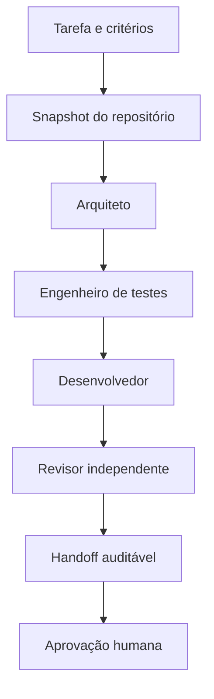

# Arquitetura

## Fontes de verdade

| Informação | Fonte |
| --- | --- |
| Escopo | arquivo em `tasks/` |
| Código atual | snapshot coletado no início da execução |
| Decisões permanentes | `docs/` e ADRs do projeto |
| Qualidade executada | CI, nunca declaração do modelo |
| Resultado da rodada | `.ai/runs/<run-id>/` |

MCP não é necessário para o MVP. Ele será útil quando o fluxo precisar consultar ferramentas externas, como issues, documentação corporativa ou bancos. Também não substitui memória: o estado pertence ao orquestrador e as fontes de verdade pertencem ao repositório.

